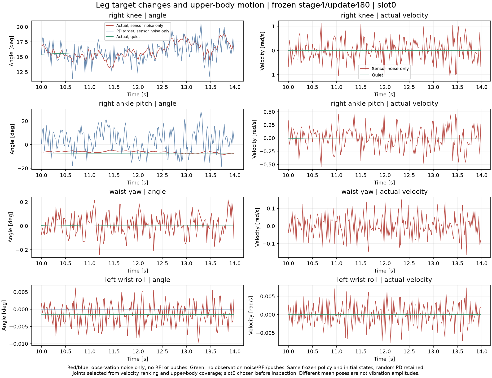
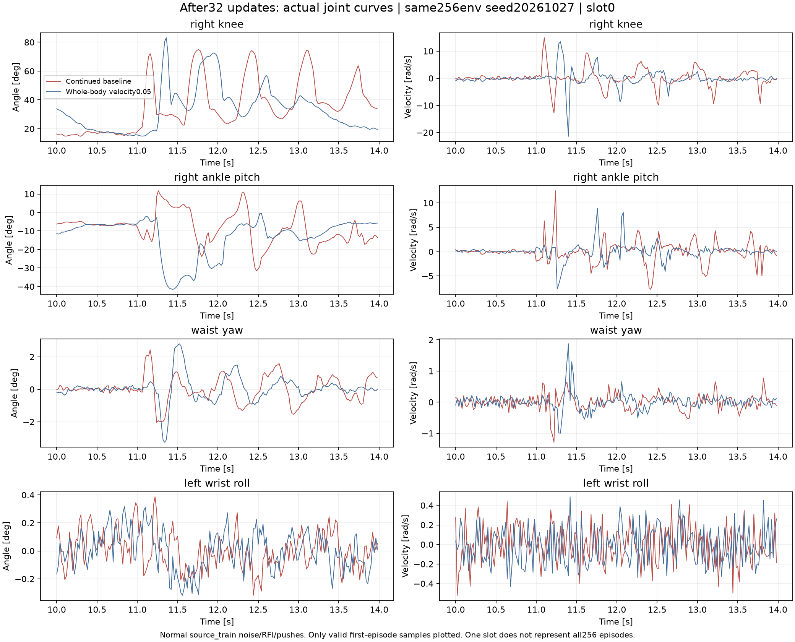

# 全身关节抖动：曲线与单项奖励对照（2026-10-27）

结论：当前证据支持“带噪观测使腿部目标快速变化，并经可动全身关节及PD保持产生耦合运动”。上肢奖励约束存在覆盖缺口，但不能把抖动全部归因于上肢。新增的全身速度惩罚在本次短训中降低了实际运动，却损害过障表现，不能作为改进策略替换当前模型。

## 直接关节证据



图为同一冻结stage4/update480模型、seed20261026、预先指定slot0的10–14s曲线。红色为仅观测噪声条件下的实际运动，蓝色为该条件PD目标，绿色为安静条件实际运动；两组均关闭RFI和推力、保留相同随机PD。因此腿部目标与腰腕运动可以在没有随机力矩或推力时出现。旧32回合审计的根部平均角速度：仅观测噪声约0.296rad/s，安静条件约0.003rad/s。

当前Actor输出12个腿部动作；上身17个关节的PD目标固定，但关节没有物理锁住。腰腕目标不变而实际角度仍波动；腿部目标则存在快速变化。仅观测噪声图中腕部幅度很小（角度轴约±0.01°），不能与膝踝运动同等看待；较大的腕部振动见保留RFI的正常条件。图不代表全部32回合，不能据单槽位幅度给所有关节排序。正常带噪条件下32回合的实际角速度RMS较大的关节为右膝、右踝pitch、左膝等；高频分析另用500Hz真实采样，50Hz曲线不用于证明25Hz以上频率变化。

奖励现状：原动作平滑只覆盖12动作；原关节平滑覆盖23关节，漏掉6个腕关节，且速度项有效系数仅-1e-8；限位内上肢姿态偏差没有独立项；body_motion未显式覆盖躯干yaw角速度。此前旧模型的xyz惩罚短训没有解决目标保持，不能把单加yaw当作已验证修复。

用户旧Gym纯PPO模型没有路径，本次没有原样复现“物理锁定上肢”开关。RFI分部位对照只是不同关节受扰，不能替代真正的锁定测试。

## 单项奖励实现

通用入口：`tools/experiments/train_cat_curriculum.py`；在新实验的protocol.json中设置：

```json
{"whole_body_joint_velocity_weight": 0.05}
```

新增正值项为`sum(actual_joint_velocity_29²)`，系数为负权重，再经过已有dt=0.02及总奖励裁剪。默认缺省时完全不启用，不改变旧schema、原奖励、PD、动作维度、观测噪声、RFI、推力和场权重。包括腕部的全部29关节均已测试。0不表示关闭，应省略键。该开关仅用于source奖励模式，recovery模式明确拒绝。

改变奖励后使用新实验目录和带父检查点哈希的`whole_body_velocity_refinement`声明做同stage Actor-only迁移；不得直接修改旧实验protocol或把改变奖励称为full resume。声明校验只允许此项schema变化，保留机器人、场景、阶段、推力等原检查。代码保留为默认关闭的实验能力；0.05不是推荐的生产权重。

## 32更新试训结果

两组均从父Actor SHA b127bcf7bf7613460f7252694612dfb291e4c63ace4fb292b6d8c82f11bf4a83出发；Actor、Critic初始化哈希一致，优化器均为空。每组32更新×4096环境×160步，共20,971,520条新转换；使用非0的4090 GPU1/6。初始化q/root/Kp/Kd/RFI哈希相同。Critic/优化器是同样的新初始化，不是恢复父Critic。

正常source_train（观测噪声、RFI、推力均保留），seed20261027，每组256回合；一次正式评估，另一次被动采集关节曲线的同种子复测。两次结果均保留：

| 条件 | 正式无碰撞成功 | 复测无碰撞成功 | 复测真实碰撞 | 复测摔倒 | 复测平均首次到达 | 最终目标保持 |
|---|---:|---:|---:|---:|---:|---:|
| 续训对照 | 224/256 | 224/256 | 32 | 0 | 5.530s | 0/256 |
| 全身速度惩罚0.05 | 190/256 | 191/256 | 63 | 6 | 6.438s | 0/256 |

同种子复测不是新训练种子。CUDA动力学与分支演化可产生轨迹差异，不应挑一次较好结果报告。相同初始状态和种子也不保证全程噪声相同：不同终止时刻会消耗不同数量的全局随机数，影响之后的RFI、观测和推力抽样。比较的是相同扰动分布下的匹配初始化。

双方均完整覆盖10–18s的249个回合中，全29关节速度平方和均值从10.3578降至6.7884，约下降34.5%；根部平均角速度从0.5207降至0.4364rad/s，约下降16.2%。这是存活条件下的配对统计，不代表全部256回合、更不是因果贡献百分比；根部角速度也包含低频晃动和受推后的恢复动作。

500Hz、slot0/1、10–14s完整窗口：腿关节>5Hz角度RMS约0.720→0.687°，上身约0.175→0.154°。这两条样本包含推力及恢复，不能据此宣称总体静止抖动已解决。最终目标保持仍为0。总奖励定义不同，不用两组总回报高低评判好坏。



图中红色为续训对照、蓝色为新增惩罚。包括受推后的大幅恢复动作，所有峰值都叫“抖动”是不准确的。slot0/1均完整有效；冻结策略的全29关节曲线与CSV保存在本次工作区outputs；试训两组的逐关节数组在work/whole-body-velocity/results。

## 验证与采用决定

本机项目496项测试通过、34项CUDA测试跳过；两组实际GPU奖励检查和训练冒烟通过，32次正式更新损失均有限，严格检查点重载及场映射检查通过，训练源码清单哈希保持不变。新增的任务refresh集成测试使用未被裁剪的正奖励输入，明确检查新增项产生非零且正确的-0.05*sum(dq²)*0.02奖励差。

不采用此候选为新默认策略：它降低了部分运动，却更慢、碰撞和摔倒更多，并未稳定停住。后续若继续，应区分行走所需关节速度和停下后的多余运动，再做单项对照；不继续盲目加大全程速度惩罚。

实验数据目录：`/home/sunxun/embodied-learning/runs/cat-feetgf-progress-stage1-20261026-01/stage4-wholebody-velocity-pilot-20261027-01`。历史模型与训练目录均保留。
